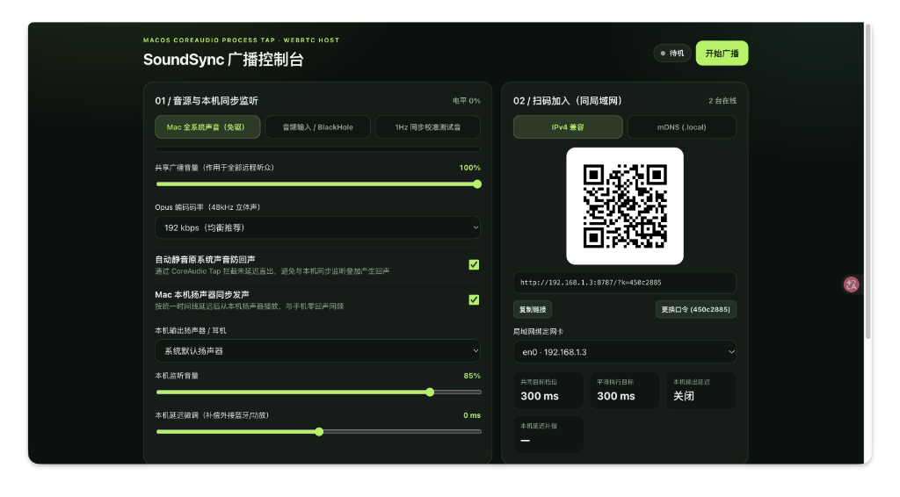

# RoomChorus — macOS 原生免驱局域网多设备同步音频系统

把 Mac 正在播放的任何声音（网易云 / 汽水音乐 / Apple Music / 视频 / 游戏 / 浏览器）实时广播到同一局域网下的 **iPhone、iPad、Android 或其他电脑**。  
**免装虚拟声卡 · 手机平板免装 App · 打开浏览器扫码即听 · Mac 本机零回声同步发声。**

---

## 界面预览



---

## 核心特性

- **macOS 原生免驱抓音（macOS 14.2+）**  
  基于 CoreAudio Process Tap（`CATapDescription` + `AudioHardwareCreateProcessTap`），无需安装 BlackHole 等第三方虚拟声卡，一键捕获全系统音频；同时也支持回退选择 BlackHole、外接声卡或内置 `1Hz` 同步校准节拍器。
- **Mac 本机零回声同频发声**  
  广播时自动排除自身进程 `AudioObjectID`，配合 `CATapMutedWhenTapped` 拦截原始未延迟直出，再由内置 `HostMonitor` 按统一时间线同步输出到 Mac 扬声器——电脑和手机一起放也不会有回声重影。
- **WebRTC + 48kHz 立体声 Opus 传输**  
  纯局域网直连（无外部 STUN/TURN，声音不离开本地 Wi-Fi），192kbps（可选 128/256kbps）立体声音乐编码，单设备带宽约 ~200kbps；移动端直接走原生 `<audio>` 与 `MediaSession`，对 iPhone 静音键和锁屏/后台播放更友好。
- **统一时间线与实用多设备玩法**
  - 主机聚合各设备的 RTT、WebRTC 抖动缓冲和输出延迟，用 9 样本中值滤波 + EMA + 滞回防抖计算共同目标延迟（250–2000ms），为每台设备独立补偿发送时间。
  - **无线立体声对箱**：可把 iPhone 设为「仅左声道」、iPad 设为「仅右声道」，随时组成左右分离音响。
  - **蓝牙 / 硬件延迟微调**：每台设备都有独立的 `-300ms ~ +300ms` 校准滑块（左拉提前、右拉延后），轻松对齐蓝牙音箱或耳机。
  - **iOS 主机侧独立控音**：针对 iOS Safari `<audio>.volume` 只读限制，自动在主机侧为该 iOS 设备实时调节音频增益，滑块同样可用。
- **超低资源占用**  
  Go 单二进制内嵌 Web 控制台与收听端网页（无需 Node.js / Docker 运行时），实测广播多台设备时仅约 ~2% CPU、~27MB 内存。

---

## 环境要求

仅广播主机端需要以下 macOS 环境；**所有收听端只需普通浏览器（Safari / Chrome / Edge）**：

- **系统**：macOS 14.2 (Sonoma) 或更新版本（支持 Apple Silicon 与 Intel）
- **工具链**：
  - Xcode Command Line Tools（`xcode-select --install`）
  - Go 1.22+（`brew install go`）
  - `opus` 与 `pkg-config`（`brew install opus pkg-config`）

---

## 快速开始（三步跑起来）

### 1. 克隆仓库并安装系统依赖

```bash
git clone https://github.com/snailuu/RoomChorus.git roomchorus
cd roomchorus
make deps
```

> `make deps` 会执行 `brew install opus pkg-config`；如果本机已安装，可跳过这一步。

### 2. 编译并启动（推荐以 `.app` 身份启动）

```bash
make run
```

或者分步执行：

```bash
make app
./dist/RoomChorus.app/Contents/MacOS/roomchorus -open
```

启动后会自动在浏览器打开主机控制台 **`http://127.0.0.1:8787/host`**，终端里也会直接打印局域网链接、8 位房间口令和终端二维码。

### 3. 首次使用授权 & 手机扫码收听

1. **开启系统音频广播**：在主机控制台点击右上角 **「开始广播」**。
   - 首次使用时，macOS 会弹出「仅系统音频录制」权限申请；
   - 如果系统未自动弹窗且页面提示「检测到系统音频连续静音」，请前往：  
     **系统设置 → 隐私与安全性 → 录屏与系统录音 → 仅系统音频录制**，开启 `RoomChorus`（或终端）的权限开关，然后再试。
   - 不放歌时，也可在控制台切换 **「1Hz 同步校准测试音」** 验证同步链路与左右声道。
2. **手机 / 平板扫码收听**：
   - 确保手机、iPad 和 Mac 连在**同一个 Wi-Fi**。
   - 用系统相机扫描控制台或终端的二维码（如遇到路由器限制 `.local`，保持默认的 **IPv4 兼容** 入口即可）。
   - 打开网页后点击 **「加入同步收听」**。

---

## 进阶玩法与常见技巧

- **组成无线立体声对箱**：在手机 A 的收听页面将「声道分配」改为 **仅左声道**，手机/iPad B 改为 **仅右声道**（也可以直接由房主在 Mac 控制台表格里帮每台设备切换）。
- **对齐蓝牙音箱或不同手机的细微时间差**：不同设备扬声器管线/蓝牙芯片有固有硬件延迟。如果听到轻微前后错位，在对应设备网页把 **「硬件 / 蓝牙延迟微调」** 往左拉（例如 `-20 ms` / `-120 ms`，代表让主机提前发给它）或往右拉即可，配置会自动保存。
- **使用 BlackHole 或麦克风**：控制台音源支持切换为 **「音频输入 / BlackHole」**，可指定任意 CoreAudio 输入设备。

---

## 命令行启动参数

```bash
./dist/RoomChorus.app/Contents/MacOS/roomchorus [参数]
```

| 参数 | 默认值 | 说明 |
| :--- | :--- | :--- |
| `-port` | `8787` | HTTP / WebSocket 监听端口 |
| `-iface` | 自动选择 | 指定绑定的局域网网卡名（如 `en0`） |
| `-source` | 空（待机） | 启动后立即开启指定音源：`system` / `input` / `test-tone` |
| `-token` | 随机 8 位 | 指定固定房间口令（重启后不更换链接，便于手机直接刷新） |
| `-no-token` | `false` | 关闭房间口令验证 |
| `-no-host-monitor` | `false` | 默认关闭 Mac 本机同步扬声器输出 |
| `-allow-remote-host` | `false` | 允许非本机 IP 访问 `/host` 控制台（默认仅 `127.0.0.1` 可访问） |
| `-open` | `false` | 启动后自动在默认浏览器打开主机控制台 |

---

## 常见问题排查（FAQ）

1. **点击「开始广播」后没声音 / 弹出连续静音提示**
   - 请检查 **系统设置 → 隐私与安全性 → 录屏与系统录音 → 仅系统音频录制** 是否已勾选 `RoomChorus`。
   - 可先切到 **「1Hz 同步校准测试音」** 确认手机和本机链路正常后再切回 `Mac 全系统声音`。
2. **手机或 iPad 打开页面一直卡在「连接中…」**
   - 检查手机/iPad 是否开启了 **VPN / 代理软件**（如 Surge / Shadowrocket / Clash / iCloud 专用代理）拦截了局域网 `192.168.x.x` 或 WebSocket 升级请求；请在规则里绕过私网网段或临时关闭代理。
   - 检查 iOS **设置 → 隐私与安全性 → 本地网络** 是否允许 **Safari** 访问本地网络。
   - 建议使用系统自带 **相机扫码 → Safari 普通标签页** 打开（部分 App 内置浏览器或开启「阻止所有 Cookie」的极端设置可能禁用 WebRTC）。
3. **两边有轻微回声或错位**
   - 确认控制台已开启 **「自动静音原系统声音防回声」**，否则 Mac 会同时响起未延迟的原声和延迟后的同步声。
   - 微小设备硬件差异通过网页 **「硬件 / 蓝牙延迟微调」** 调整 `-10ms` ~ `-30ms` 即可完全对齐。
4. **iPhone 拖动音量滑块有效吗？**
   - 有效。页面会自动识别 iOS 设备无法直接修改 `<audio>.volume` 的限制，改为通过主机侧独立 Opus 编码器实时调整增益（滑块旁会标注 `(主机控音)`）。

---

## 架构与源码结构

```text
roomchorus/
├── cmd/roomchorus/main.go            # CLI 入口、参数解析、终端二维码与优雅退出
├── internal/
│   ├── audio/
│   │   ├── coreaudio_darwin.{h,m}    # CoreAudio Process Tap + 无锁 SPSC 环 + HALOutput HostMonitor
│   │   ├── capture_darwin.go         # Go CGO 封装与设备枚举/静音检测
│   │   └── testtone.go               # 48kHz 1Hz 同步校准节拍器
│   ├── opus/opus.go                  # libopus CGO 封装（48kHz 立体声 20ms Music 模式）
│   ├── sync/controller.go            # 共同时间线算法（中值滤波 + EMA + 滞回防抖 + 平滑斜率）
│   ├── rtc/
│   │   ├── peer.go                   # LAN-only WebRTC PeerConnection 与每设备有界延迟队列
│   │   └── hub.go                    # 共享声道编码与按需 iOS 独立增益编码路由
│   ├── netutil/                      # 局域网 IPv4 网卡挑选、子网校验、dns-sd mDNS、二维码生成
│   └── server/
│       ├── server.go                 # HTTP/WebSocket 信令、四时间戳校时与访问安全边界
│       └── web/                      # go:embed 内嵌控制台 (host.html/js) 与移动端页 (index.html/listener.js)
├── scripts/build-app.sh              # 构建并签名 dist/RoomChorus.app
├── Info.plist                        # macOS NSAudioCaptureUsageDescription 权限声明
└── Makefile
```

### 本地开发与测试

```bash
# 编译命令行单文件 bin/roomchorus
make build

# 编译 .app 包 dist/RoomChorus.app
make app

# 运行全部单元测试与真实 WebRTC+Opus 端到端集成测试（带竞态检查）
make test

# 清理构建产物
make clean
```

---

## 安全边界与开源许可

- **纯局域网运行**：仅绑定所选局域网私网 IPv4，校验访问来源同子网，禁用外部 STUN/TURN，音频传输经由 WebRTC DTLS-SRTP 加密。
- **控制台隔离**：`/host` 控制台及控制 API 默认仅允许本机回环（`127.0.0.1` / `::1`）访问；收听端默认启用 8 位加入口令。请仅在可信局域网内使用。
- **许可协议**：本项目基于 [MIT License](LICENSE) 开源。
